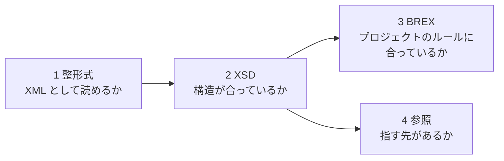

ここまでの章で、DM の XML を読みました。この章からは、書かれた XML が決まりに合っているかを確かめます。最初の段階は XML スキーマ（XSD）による検証です。要素の名前、並びの順、必須の要素、属性の値の型を機械が確かめます。

XSD は、仕様パッケージの XML Schema Package に入っています。置き方は「[仕様パッケージを手元に置く](https://zenn.dev/shuji_bonji/books/s1000d-practice/viewer/spec-package)」で説明しました。

## 確かめる段階

DM を確かめる作業は 4 つの段階に分かれます。前の段階が通っていないと、後の段階の結果は当てになりません。



| 段階 | 確かめること | 扱う章 |
| --- | --- | --- |
| 整形式 | タグが閉じている、などの XML としての正しさ | この章 |
| XSD | 要素と属性の名前、順、必須、値の型 | この章 |
| BREX | プロジェクトが決めた、値と構造の使い方 | BREX で確かめる |
| 参照 | 指す先の DM・図・`id` があるか | 参照と図をたどる |

## どのスキーマで検証するか

検証に使うスキーマは DM 自身が指定しています。ルート要素の `xsi:noNamespaceSchemaLocation` です。

```xml
<dmodule xmlns:xsi="http://www.w3.org/2001/XMLSchema-instance"
  xsi:noNamespaceSchemaLocation="http://www.s1000d.org/S1000D_7/xml_schema_flat/proced.xsd">
```

この値は URL の形をしていますが、検証のたびに、この URL からスキーマを取ってくるわけではありません。URL の末尾のファイル名（`proced.xsd`）と S1000D の Issue（`S1000D_7`）を見て、コンピューターに置いた仕様パッケージの中の、同じ名前のスキーマを使います。

Issue が違うスキーマでは検証できません。Issue 7 の DM を Issue 4.1 のスキーマで検証すると、名前が変わった要素がすべてエラーになります。

## XSD が見つけるもの

券売機の手順の DM に、わざと誤りを 2 つ入れて、検証します。

1. 発行日の月を `13` にする。
2. 手順の段落の後ろにスキーマに無い要素 `memo` を足す。

```xml
<issueDate year="2026" month="13" day="25"/>
```

```xml
<proceduralStep id="scr-station">
  <title>STEP2</title>
  <para>到着駅を選びます。</para>
  <memo>文言を確認中</memo>
  …
```

s1000d-verify-mcp の [`validate_schema`](https://shuji-bonji.github.io/s1000d-stack/ja/reference/stack/verify/validate-schema/) の結果は、`invalid` で、エラーが 2 件です。

| 行 | 場所 | エラーの文 |
| --- | --- | --- |
| 15 | `…/dmAddressItems/issueDate` | Element 'issueDate', attribute 'month': [facet 'maxInclusive'] The value '13' is greater than the maximum value allowed ('12'). |
| 66 | `…/mainProcedure/proceduralStep/memo` | Element 'memo': This element is not expected. Expected is one of ( proceduralStep, proceduralStepAlts ). |

エラーの文は、検証のライブラリ（libxml2）が出す英語の文です。読み方を 2 件で説明します。

**1 件目**は値の型の誤りです。`month` 属性は 1 から 12 までの数と決まっています。`facet 'maxInclusive'` は、上限の決まりに当たった、という意味です。

**2 件目**は並びの誤りです。`This element is not expected` は、その場所にその要素を置けない、という意味です。続く `Expected is one of ( … )` が、その場所に置ける要素の一覧です。

2 件目のエラーには役に立つ情報が入っています。`memo` を置いた場所で、スキーマが置けるとしているのは、`proceduralStep` か `proceduralStepAlts` でした。段落や図は、もう置けない場所だった、ということです。前の章で見た、「手順の中では、段落の後に下の階層の手順が来る」という順が、ここに現れています。

:::message
並びの誤りのエラーは、誤りのある要素ではなく、その次の要素の場所で出ることがあります。必須の要素を書き忘れたときは、「次に来た要素は、ここには置けない」というエラーになります。エラーの行だけを見ずに、`Expected is one of` の一覧を見て、何が足りないかを考えます。
:::

## XSD が見つけないもの

XSD の検証が通っても確かめられていないことがあります。

| 見つけないもの | 例 | 確かめる方法 |
| --- | --- | --- |
| プロジェクトが禁じた値 | 機密区分 `05`（スキーマは 2 桁の番号なら通す） | BREX |
| ほかの DM との関係 | 指す先の DM が CSDB にあるか | 参照の確認 |
| ファイル名との一致 | ファイル名は `001-00` なのに、中身は `002-00` | ファイル名と中身を比べる |
| 属性どうしの関係 | 最初の発行（`001-00`）なのに、`issueType` が `changed` | 既定 BREX |
| 内容の適切さ | 警告にすべきものを注意に書いている | 人によるレビュー |

同じ DM の中の `id` を指す属性は XSD が確かめます。指す先の `id` が無いと、XSD のエラーになります。

## 確かめ方

券売機の CSDB の全体を s1000d-verify-mcp の [`verify_csdb`](https://shuji-bonji.github.io/s1000d-stack/ja/reference/stack/verify/verify-csdb/) で検証すると、DM とパブリケーションモジュールの 17 件すべてが、XSD の検証を通ります。

検証の結果では次の 3 つを必ず見ます。

| 見るもの | 理由 |
| --- | --- |
| 状態が `valid` か | `invalid` のほかに、スキーマが見つからなかった状態（`schema-not-found`）と、検証を行わなかった状態（`not-run`）がある。この 2 つは、通ったことにならない |
| 使ったスキーマの場所 | 仕様パッケージの正しい側のフォルダーか |
| S1000D の Issue | DM の Issue と、スキーマの Issue が同じか |

検証の結果を記録に残すときは、「通った」だけでなく、どのスキーマで、いつ検証したかも残します。スキーマの Issue が違えば、同じ DM でも結果が変わるためです。

## 実装するときの注意

### 検証のライブラリの選び方

JavaScript だけで書かれた、S1000D の規模の XSD を検証できるライブラリは、見つかりませんでした。s1000d-core は、C のライブラリ libxml2 を WebAssembly にしたものを使っています。候補を 2 つ、Issue 7 のスキーマ 33 本と、公式サンプルの DM 106 件で比べました。

| 観点 | `xmllint-wasm` 5.3.0 | `libxml2-wasm` 0.7.2 |
| --- | --- | --- |
| 判定 | 106 件すべて適合。入れた誤り 3 種を検出 | 同じ |
| 106 件の検証にかかった時間 | 7.8 秒 | 0.27 秒 |
| スキーマの扱い | 呼び出すたびに、スキーマを読み込み直す | 読み込んだスキーマを使い回せる |

判定は同じで、速さが約 30 倍違いました。CSDB の全体を検証する使い方では、同じスキーマで多くの DM を検証するので、スキーマを使い回せる方を選びました。

### `xs:import` を解決する

S1000D の各スキーマは、共通のスキーマ（`xml.xsd`、`xlink.xsd`、`rdf.xsd`）を `xs:import` で読み込みます。読み込み先を解決できないと、スキーマの読み込みの段階で失敗します。

WebAssembly の中からは、ファイルシステムが直接は見えません。`libxml2-wasm` では、同じフォルダーのスキーマを名前と中身の組として登録しておくと、`xs:import` がそこから解決されます。この登録の機能は、まだ安定版ではない扱い（alpha）なので、s1000d-core は、検証の処理を 1 つのインターフェースの後ろに置いています。機能の形が変わっても、直す場所が 1 か所で済むようにするためです。

データ辞書の側の `xml_schema_flat/` が使えない理由も、`xs:import` です。読み込み先がインターネット上の URL で書かれていて、ライブラリがネットワークに接続しようとして失敗します。

### メモリーを解放する

`libxml2-wasm` の文書と検証器のオブジェクトは、使い終わったら、明示して解放する必要があります。s1000d-core は、検証器をスキーマごとに 1 つ作って使い回し、文書は、検証のたびに解放しています。

### DOCTYPE の宣言は別のパーサーで読む

`libxml2-wasm` には、DOCTYPE の `ENTITY` 宣言と `NOTATION` 宣言を列挙する機能がありません。図への参照を解決するための宣言の読み取りは、別のパーサー（`@xmldom/xmldom`）で行っています。XSD の検証と、宣言の読み取りで、同じ XML を 2 回読むことになります。

## この章のポイント

- 検証に使うスキーマは DM のルート要素が指しています。URL から取ってくるのではなく、コンピューターに置いた同じ名前のスキーマを使います。
- 並びの誤りのエラーは、`Expected is one of` の一覧を見て、その場所に何が置けるかを読みます。
- XSD の検証は構造だけを確かめます。プロジェクトのルール、ほかの DM との関係、内容の適切さは、別の方法で確かめます。
- 検証の結果は、状態、使ったスキーマの場所、S1000D の Issue の 3 つを見ます。

## 出典

- 著者が入手した S1000D Issue 7 のパッケージ（XML Schema Package、Bike Samples）。入手先は https://users.s1000d.org/
- libxml2-wasm. https://github.com/jameslan/libxml2-wasm
- xmllint-wasm. https://github.com/notengrafik/xmllint-wasm
